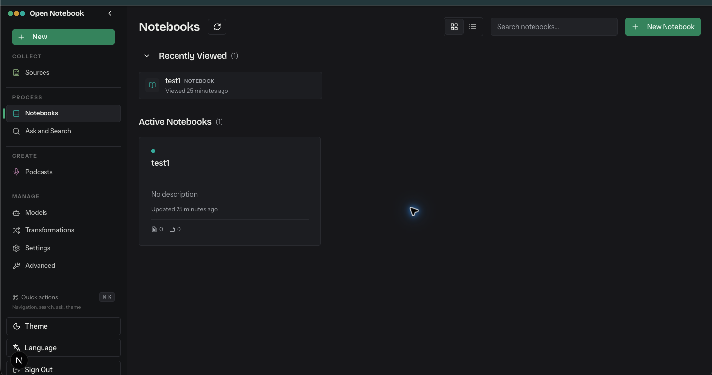

# Notebooks

- Route: `{route}`
- ภาพ: [เปิดภาพ](../crop/01-notebooks.png)

## หน้าที่ของหน้า

รวมและจัดการสมุดบันทึกที่ใช้รวบรวมแหล่งข้อมูลสำหรับแต่ละหัวข้อ

## Components ที่เห็น

- **แถบนำทางด้านข้าง:** พาไป Sources, Notebooks, Ask and Search, Podcasts และส่วนจัดการ Models, Transformations, Settings, Advanced
- **Recently Viewed:** ทางลัดไปยัง Notebook ที่เปิดล่าสุด ช่วยกลับไปทำงานต่อ
- **Active Notebooks:** แสดงสมุดบันทึกเป็นการ์ดหรือรายการ พร้อมชื่อ คำอธิบาย เวลาแก้ไข และจำนวนแหล่งข้อมูล/โน้ต
- **เครื่องมือรายการ:** สลับมุมมอง ค้นหา รีเฟรช และสร้าง Notebook ใหม่

## หมายเหตุสำหรับนำโครงสร้างไปปรับใช้

จัดหน้าเป็น shell ร่วมที่คง Sidebar ไว้ แล้วแยกส่วนเนื้อหาหลักเป็นการ์ด/แผงตามงานของหน้านั้น ๆ; สถานะว่าง คำเตือน และสถานะกำลังทำงานช่วยบอกความพร้อมของข้อมูลและโมเดลให้ชัดเจน.
