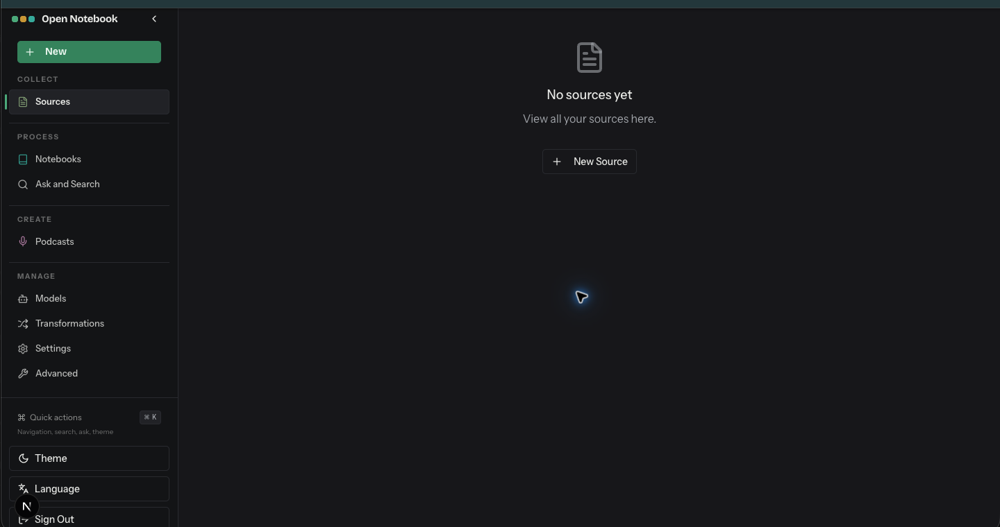

# Sources

- Route: `{route}`
- ภาพ: [เปิดภาพ](../crop/02-sources.png)

## หน้าที่ของหน้า

หน้ารวมเอกสารและ URL ที่นำเข้ามาใช้เป็นแหล่งอ้างอิง

## Components ที่เห็น

- **แถบนำทางด้านข้าง:** คงอยู่ระหว่างหน้าหลัก ใช้เปลี่ยนพื้นที่ทำงาน
- **Empty state:** เมื่อยังไม่มีข้อมูล แสดงข้อความ “No sources yet” และอธิบายว่ารายการแหล่งข้อมูลจะแสดงตรงนี้
- **New Source:** เริ่มเพิ่มแหล่งข้อมูลใหม่ เช่น เอกสารหรือ URL; เมื่อมีข้อมูล หน้านี้เป็นจุดเรียกดูและเปิดรายละเอียด Source

## หมายเหตุสำหรับนำโครงสร้างไปปรับใช้

จัดหน้าเป็น shell ร่วมที่คง Sidebar ไว้ แล้วแยกส่วนเนื้อหาหลักเป็นการ์ด/แผงตามงานของหน้านั้น ๆ; สถานะว่าง คำเตือน และสถานะกำลังทำงานช่วยบอกความพร้อมของข้อมูลและโมเดลให้ชัดเจน.
