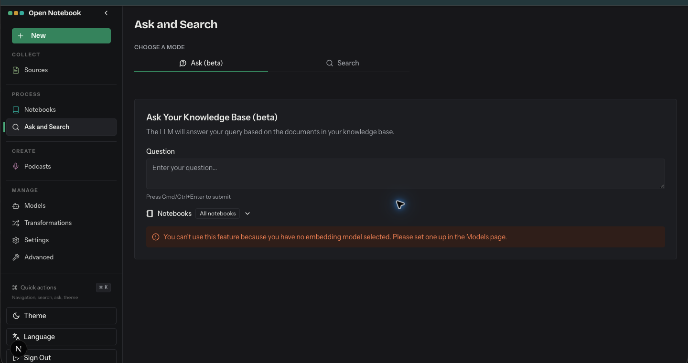

# Ask and Search

- Route: `{route}`
- ภาพ: [เปิดภาพ](../crop/03-ask-and-search.png)

## หน้าที่ของหน้า

ถามคำถามจากเนื้อหาในแหล่งข้อมูล หรือค้นหาข้อมูลในคลัง

## Components ที่เห็น

- **ตัวเลือกโหมด:** สลับ Ask (beta) กับ Search ภายในหน้าเดียว
- **Ask Your Knowledge Base:** ช่องป้อนคำถามและคำอธิบายว่าคำตอบอิงจากเอกสารในคลัง
- **ขอบเขต Notebook:** เลือก Notebook หรือใช้ทุก Notebook เพื่อจำกัดชุดข้อมูลที่ถาม
- **สถานะความพร้อม:** มีข้อความเตือนว่าต้องกำหนด Embedding Model ก่อน จึงจะใช้ฟังก์ชันนี้ได้; หลังถาม ระบบแสดงคำตอบและแหล่งอ้างอิง

## หมายเหตุสำหรับนำโครงสร้างไปปรับใช้

จัดหน้าเป็น shell ร่วมที่คง Sidebar ไว้ แล้วแยกส่วนเนื้อหาหลักเป็นการ์ด/แผงตามงานของหน้านั้น ๆ; สถานะว่าง คำเตือน และสถานะกำลังทำงานช่วยบอกความพร้อมของข้อมูลและโมเดลให้ชัดเจน.
