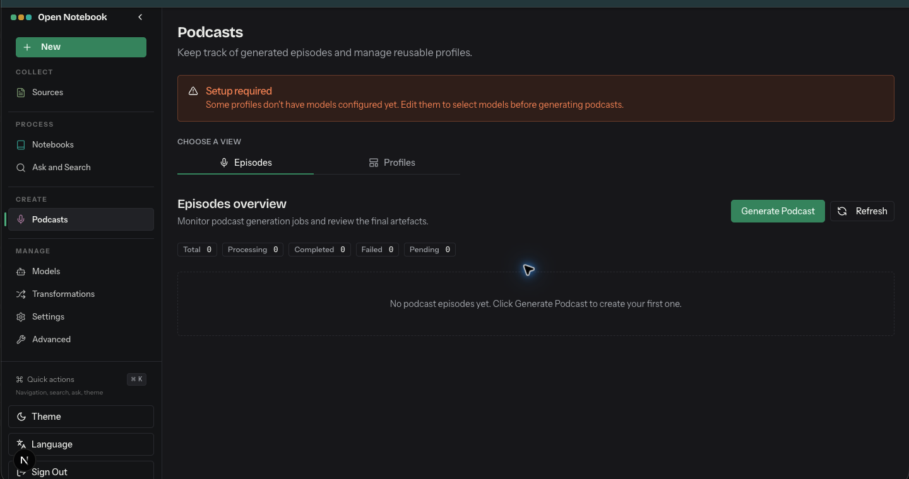

# Podcasts

- Route: `{route}`
- ภาพ: [เปิดภาพ](../crop/04-podcasts.png)

## หน้าที่ของหน้า

สร้างและติดตามตอนพอดแคสต์ พร้อมจัดการโปรไฟล์ที่นำกลับมาใช้ซ้ำ

## Components ที่เห็น

- **แถบ Setup required:** แจ้งว่าโปรไฟล์บางรายการยังไม่มีโมเดลที่ต้องใช้
- **Episodes / Profiles:** สลับระหว่างรายการตอนกับการจัดการโปรไฟล์เสียง/รูปแบบ
- **Episodes overview:** ตัวนับสถานะ Total, Processing, Completed, Failed และ Pending ใช้ติดตามงานสร้าง
- **Generate Podcast / Refresh:** เริ่มสร้างพอดแคสต์และโหลดสถานะล่าสุด; รายการตอนจะแสดงผลลัพธ์ให้เปิดตรวจ

## หมายเหตุสำหรับนำโครงสร้างไปปรับใช้

จัดหน้าเป็น shell ร่วมที่คง Sidebar ไว้ แล้วแยกส่วนเนื้อหาหลักเป็นการ์ด/แผงตามงานของหน้านั้น ๆ; สถานะว่าง คำเตือน และสถานะกำลังทำงานช่วยบอกความพร้อมของข้อมูลและโมเดลให้ชัดเจน.
