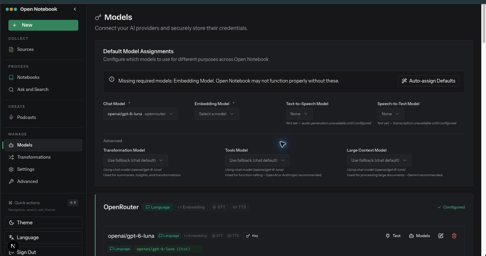

# Models

- Route: `{route}`
- ภาพ: [เปิดภาพ](../crop/05-models.png)

## หน้าที่ของหน้า

เชื่อมต่อผู้ให้บริการ AI และกำหนดโมเดลตามประเภทงาน

## Components ที่เห็น

- **Default Model Assignments:** เลือกโมเดลแชต, embeddings, text-to-speech และ speech-to-text
- **Advanced assignments:** กำหนดโมเดลสำหรับ transformations, tools และเอกสารบริบทยาว โดยเลือก fallback ได้
- **Provider cards:** แสดงผู้ให้บริการที่ตั้งค่าไว้และรุ่นโมเดล พร้อมการทดสอบ/จัดการรายการ/แก้ไข credential
- **สถานะที่เห็นในภาพ:** OpenRouter แสดงว่า configured และมี Chat Model; Embedding Model ยังไม่ได้เลือก จึงมีคำเตือนว่าความสามารถบางอย่างทำงานไม่ครบ

## หมายเหตุสำหรับนำโครงสร้างไปปรับใช้

จัดหน้าเป็น shell ร่วมที่คง Sidebar ไว้ แล้วแยกส่วนเนื้อหาหลักเป็นการ์ด/แผงตามงานของหน้านั้น ๆ; สถานะว่าง คำเตือน และสถานะกำลังทำงานช่วยบอกความพร้อมของข้อมูลและโมเดลให้ชัดเจน.
