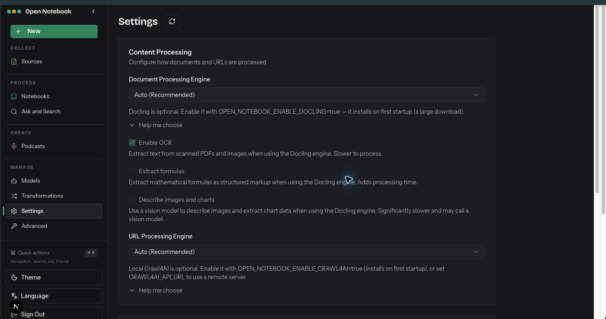

# Settings

- Route: `{route}`
- ภาพ: [เปิดภาพ](../crop/06-settings.png)

## หน้าที่ของหน้า

กำหนดวิธีประมวลผลเอกสารและ URL ที่นำเข้า

## Components ที่เห็น

- **Content Processing:** การ์ดตั้งค่า engine สำหรับประมวลผลเอกสาร
- **Document Processing Engine:** เลือก Auto หรือ engine อื่น พร้อมตัวเลือก OCR, แยกสูตร และอธิบายภาพ/กราฟ
- **URL Processing Engine:** เลือกวิธีดึงและประมวลผลเนื้อหาจาก URL พร้อมส่วนช่วยเลือก
- **หน้าต่อเนื่องด้านล่าง:** หน้าตั้งค่ามีหลายส่วนและเลื่อนลงได้; ภาพนี้บันทึกส่วนบนของหน้า

## หมายเหตุสำหรับนำโครงสร้างไปปรับใช้

จัดหน้าเป็น shell ร่วมที่คง Sidebar ไว้ แล้วแยกส่วนเนื้อหาหลักเป็นการ์ด/แผงตามงานของหน้านั้น ๆ; สถานะว่าง คำเตือน และสถานะกำลังทำงานช่วยบอกความพร้อมของข้อมูลและโมเดลให้ชัดเจน.
