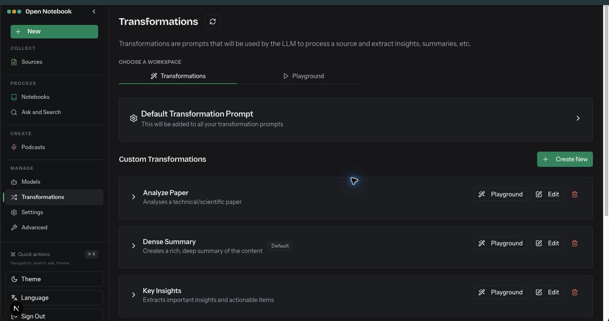

# Transformations

- Route: `{route}`
- ภาพ: [เปิดภาพ](../crop/07-transformations.png)

## หน้าที่ของหน้า

จัดการ prompt ที่ใช้สรุป วิเคราะห์ และดึง insight จาก Source

## Components ที่เห็น

- **Workspace tabs:** สลับรายการ Transformations กับ Playground สำหรับทดลอง prompt
- **Default Transformation Prompt:** ตั้ง prompt กลางที่ต่อท้ายให้กับ transformation ต่าง ๆ
- **Custom Transformations:** รายการ prompt ที่มี เช่น Analyze Paper, Dense Summary และ Key Insights
- **Actions ต่อรายการ:** ขยายดูรายละเอียด เปิด Playground แก้ไข หรือลบ transformation; Create New เพิ่มรายการใหม่

## หมายเหตุสำหรับนำโครงสร้างไปปรับใช้

จัดหน้าเป็น shell ร่วมที่คง Sidebar ไว้ แล้วแยกส่วนเนื้อหาหลักเป็นการ์ด/แผงตามงานของหน้านั้น ๆ; สถานะว่าง คำเตือน และสถานะกำลังทำงานช่วยบอกความพร้อมของข้อมูลและโมเดลให้ชัดเจน.
