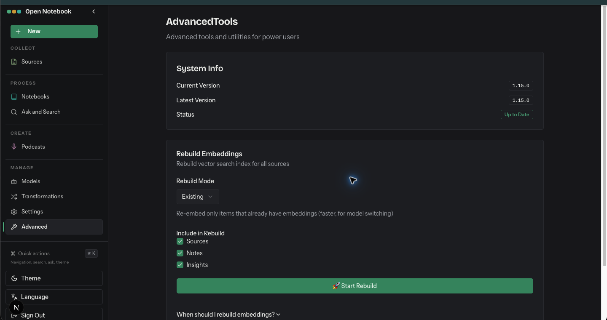

# Advanced

- Route: `{route}`
- ภาพ: [เปิดภาพ](../crop/08-advanced.png)

## หน้าที่ของหน้า

เครื่องมือดูสถานะระบบและจัดการดัชนีค้นหาเชิงเวกเตอร์

## Components ที่เห็น

- **System Info:** แสดงเวอร์ชันที่ติดตั้ง เวอร์ชันล่าสุด และสถานะอัปเดต
- **Rebuild Embeddings:** เลือกโหมดสร้างดัชนีใหม่และกำหนดว่าจะรวม Sources, Notes และ Insights
- **Start Rebuild:** เริ่มงานสร้าง embedding ใหม่; มีส่วนช่วยอธิบายด้านล่าง

## หมายเหตุสำหรับนำโครงสร้างไปปรับใช้

จัดหน้าเป็น shell ร่วมที่คง Sidebar ไว้ แล้วแยกส่วนเนื้อหาหลักเป็นการ์ด/แผงตามงานของหน้านั้น ๆ; สถานะว่าง คำเตือน และสถานะกำลังทำงานช่วยบอกความพร้อมของข้อมูลและโมเดลให้ชัดเจน.
