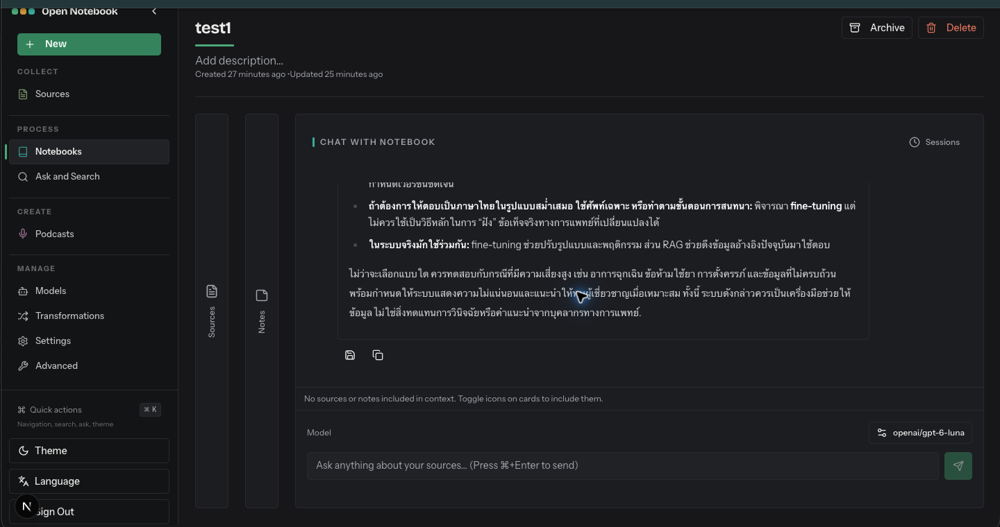

# Notebook detail

- Route: `{route}`
- ภาพ: [เปิดภาพ](../crop/09-notebook-detail.png)

## หน้าที่ของหน้า

พื้นที่ทำงานของ Notebook หนึ่งเล่ม รวมแหล่งข้อมูล โน้ต และการสนทนากับ AI

## Components ที่เห็น

- **หัว Notebook:** แสดงชื่อ/คำอธิบายและวันสร้าง-อัปเดต พร้อมคำสั่ง Archive และ Delete
- **Sources / Notes columns:** แผงข้างสำหรับดูและเลือก Source กับ Note ที่จะใส่ในบริบทของคำตอบ
- **Chat with Notebook:** แสดงบทสนทนาและคำตอบของโมเดลในบริบท Notebook
- **Session และ Model:** เปิด Sessions เพื่อจัดการบทสนทนา และเลือกโมเดลก่อนส่งคำถาม
- **ตัวเลือกบริบท:** สถานะใต้คำตอบบอกว่า Source/Note ใดถูกนำเข้า context; ในภาพนี้ไม่มีรายการใดถูกรวม

## หมายเหตุสำหรับนำโครงสร้างไปปรับใช้

จัดหน้าเป็น shell ร่วมที่คง Sidebar ไว้ แล้วแยกส่วนเนื้อหาหลักเป็นการ์ด/แผงตามงานของหน้านั้น ๆ; สถานะว่าง คำเตือน และสถานะกำลังทำงานช่วยบอกความพร้อมของข้อมูลและโมเดลให้ชัดเจน.
